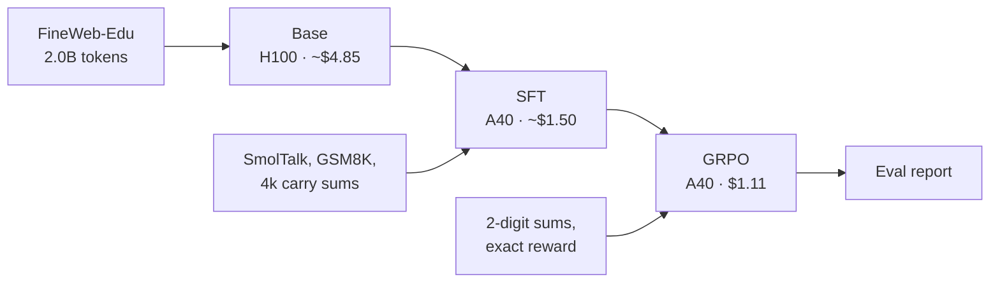

# Results: a 100M GPT trained from scratch, then SFT and GRPO

This document reports the first full cloud run of this repo:

- pretraining a 101M-parameter GPT on 2B tokens;
- supervised fine-tuning (SFT) on chat and arithmetic data;
- reinforcement learning with GRPO on verifiable arithmetic rewards.

The total cost was about $26 of rented GPU time, against a $100 cap.

The arithmetic task is deliberately small: 2-digit addition with a written
carry procedure. It is small enough to run cheaply and verify exactly, and
large enough to show each stage working.

On 500 held-out prompts:

| Metric | SFT | GRPO |
| --- | ---: | ---: |
| Greedy exact match | 32.0% | **46.6%** |
| Sampled pass@1 (T = 0.8) | 9.3% | 19.0% |
| Sampled pass@8 | 48.6% | 63.8% |

GRPO adds 14.6 points of greedy accuracy over its SFT starting point. The
weights are on Hugging Face at
[`cameronervin1/nanogpt-100m`](https://huggingface.co/cameronervin1/nanogpt-100m).

## Pipeline



Every stage writes checksummed checkpoints and a manifest that names its
parent, so each result traces back to its data and config. See
[design.md](design.md) for the model and stage details and
[runbook.md](runbook.md) for the commands.

## Base model

| | |
| --- | --- |
| Architecture | 12 layers, width 768, GQA (12 query / 4 KV heads), RoPE, SwiGLU, RMSNorm |
| Parameters | 101M |
| Data | FineWeb-Edu `sample-10BT`, 2,000,158,720 tokens |
| Steps | 7,630 on one H100 SXM, 480k tokens/s |
| Validation loss | 3.250 (perplexity 25.8, 1.019 bits/byte) |

The throughput probe projected the base stage at $5.54. It came in at
about $4.85.

## Answer format

The SFT and GRPO arithmetic data ask questions of the form
`What is 47 + 38? End with <final>answer</final>.`

The first SFT runs trained the model to answer with the bare sum. The
byte-level BPE tokenizer merges a number such as `85` into a single token,
so the whole answer was one prediction with no intermediate steps. That
version reached 30% held-out accuracy. GRPO and plain supervised updates on
arithmetic both lowered it, so the problem was the answer format, not the RL
algorithm.

The carry format writes the sum column by column, with every digit as its
own token:

```text
ones: 7 + 8 = 1 5, write 5 carry 1
tens: 4 + 3 + 1 = 8, write 8
digits: 8 5
<final>85</final>
```

With this format, SFT learns 2-digit addition reliably. Each column is a
small, local step, and a wrong answer is usually wrong in one column.

## What GRPO needs to learn

GRPO samples a group of 8 answers per prompt and scores each one: 1 if the
final number is right, 0 if not. Each answer's advantage is its score minus
the group mean, normalized by the group's spread. The policy then moves
toward the above-average answers.

This only gives a signal when a group is **mixed**, with some right and some
wrong answers. Groups that are all right or all wrong have zero advantage
everywhere. So GRPO can raise single-sample accuracy (pass@1) only toward
what the model can already reach in several tries (pass@k). The gap between
the two is the room GRPO has to work with.

The repo checks this before training. The GRPO pilot samples 128 prompts and
stops the stage unless:

- at least 5% of samples are correct;
- at least 20% of groups are mixed.

Earlier runs hit both failure modes:

| SFT data | Held-out greedy | Pilot result |
| --- | ---: | --- |
| 200k carry-format sums | 100% | 99.4% correct, 4.7% mixed groups: saturated, stopped |
| Same model on 3- to 5-digit sums | 0% | No correct samples: no signal |

## Setting the SFT data budget

The final run sets the SFT data so that the model ends in the useful range.
SFT mixes SmolTalk chat and GSM8K with 4,000 carry-format sums. Over 2,000
steps the model sees about 2,500 of those sums.

SFT logs held-out accuracy every 250 steps, so the curve is visible during
training:

<picture>
  <source media="(prefers-color-scheme: dark)" srcset="assets/sft-heldout-dark.svg">
  
</picture>

Before any GRPO spend, a go/no-go check ran on 500 held-out prompts:

| Check | Required | Final SFT checkpoint |
| --- | --- | ---: |
| Greedy pass@1 | 15% to 70% | 32% |
| pass@8 minus sampled pass@1 | at least 20 points | 35 points (44% vs 8.7%) |
| Mixed groups | at least 20% | 44% |

All three passed. The config also supports starting GRPO from an
intermediate SFT checkpoint (`grpo.init_step`), as a fallback if the final
checkpoint had been too accurate.

## GRPO

A short sweep compared two learning rates over 60 steps. Both used 64
prompts × 8 samples per step and KL weight 0.02.

| Learning rate | Held-out at step 20 / 40 / 60 | KL at step 60 |
| --- | --- | ---: |
| 1e-6 | 35% / 36% / 43.5% | 0.010 |
| 3e-6 | 22.5% / 28% / 41% | 0.020 |

The higher rate first fell below the SFT baseline. The full run used 1e-6
for 150 steps. Its pilot found 9.8% correct samples and 48% mixed groups,
well above the thresholds.

<picture>
  <source media="(prefers-color-scheme: dark)" srcset="assets/grpo-heldout-dark.svg">
  
</picture>

| | Start | Step 150 |
| --- | ---: | ---: |
| Mean training reward | 0.10 | 0.19 |
| KL to the SFT reference | 0 | 0.014 |
| Held-out greedy (200 prompts) | 34% | 43% |

The run took 1.85 hours on an A40 and cost $1.11.

## Final evaluation

`nanogpt eval` scores both checkpoints on the same 500 held-out prompts. It
uses greedy decoding plus 8 samples per prompt at the GRPO sampling settings
(T = 0.8, top-k 50).

<picture>
  <source media="(prefers-color-scheme: dark)" srcset="assets/final-eval-dark.svg">
  
</picture>

| Metric | SFT | GRPO |
| --- | ---: | ---: |
| Greedy exact match | 32.0% | 46.6% |
| Sampled pass@1 | 9.3% | 19.0% |
| Sampled pass@8 | 48.6% | 63.8% |
| Mixed groups | 48.4% | 63.6% |
| Format valid | 100% | 100% |

Sampled pass@1 doubled. pass@8 rose too, by 15 points. Within 150 steps,
GRPO did more than turn the best of 8 samples into the first one: it widened
the set of prompts the model can solve at all.

Release gates in `eval/report.json`:

| Gate | Result |
| --- | --- |
| Base loss finite | pass |
| SFT format valid ≥ 95% | pass (100%) |
| GRPO exact match ≥ SFT + 10 points | pass (+14.6) |
| No regression on the easiest digit bucket | pass |
| Within budget | pass |

## Cost

| Session | GPU | Work | Cost |
| --- | --- | --- | ---: |
| 1 | H100 SXM | Probe, base, first SFT, GRPO pilot (stopped) | $15.2 |
| 2 | A40 | Second SFT, first full GRPO | $3.0 |
| 3 | A40 | GRPO diagnosis: sweeps and a supervised control | $0.5 |
| 4 | A40 | Carry-format SFT (saturated at 100%) | $1.8 |
| 5 | A40 | Digit-length diagnosis, 3-digit SFT | $2.2 |
| 6 | A40 | Final SFT, go/no-go check, sweep, GRPO, eval | $3.2 |
| | | **Total, including volume storage** | **$26.0** |

About $1.70 of session 1 went to an evaluation that decoded slowly because
of a tokenizer bug. It is fixed: `HFTokenizer` now caches its vocabulary
size.

## Limitations

- The task is 2-digit addition. Accuracy drops to 0% on lengths the model
  never saw in training, because each multi-digit operand is a single token.
- 46.6% greedy accuracy is far from solved. This run shows the pipeline and
  method working, not a capable arithmetic model.
- Held-out prompts use different random seeds but the same operand range as
  training prompts.
- GSM8K is in the SFT mix, but GSM8K accuracy is not measured.
- All numbers are from single runs, with no seed repeats.

## Next steps

- **Digit-spaced prompts.** Write operands as `4 7 + 3 8`, so the model sees
  single-digit tokens and can attempt lengths it was not trained on. That
  gives GRPO a partly solved bucket (4 to 5 digits) to work on.
- **Longer GRPO.** Held-out accuracy and pass@8 were both still rising at
  step 150.
- **CLI checks.** Move the go/no-go check and the learning-rate sweep from
  [`scripts/experiments/`](../scripts/experiments) into `nanogpt` commands.

## Reproduce

```bash
export NANOGPT_HOME=/workspace/artifacts NANOGPT_HOURLY_RATE_USD=<price>
uv run nanogpt train sft  --config configs/runs/cloud.yaml --yes --resume
uv run nanogpt train grpo --config configs/runs/cloud.yaml --yes
uv run nanogpt eval       --config configs/runs/cloud.yaml --yes
```

Released checkpoints, with the sha256 of each `model.safetensors`:

| Folder | Stage | sha256 |
| --- | --- | --- |
| `release/base` | Base | `156d9cbb…69e1` |
| `release/sft` | SFT | `979bfc16…39e3` |
| `release/grpo` | GRPO | `fc9dd38b…08c9` |

The charts come from [`assets/make_charts.py`](assets/make_charts.py).
