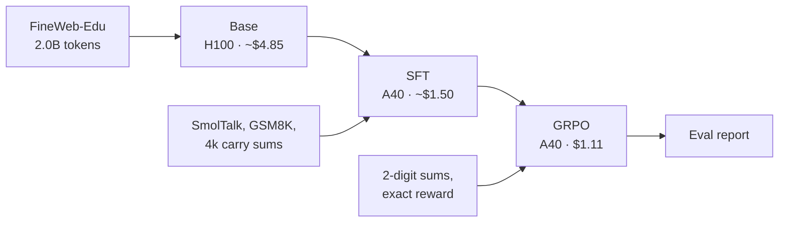
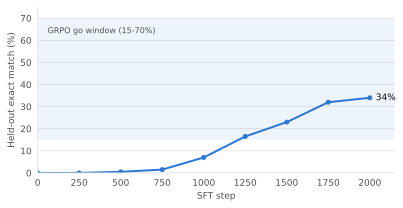
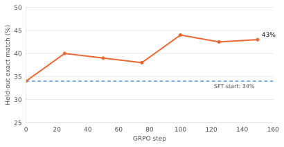
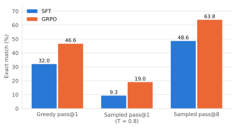

# Results: a 100M GPT trained from scratch, then SFT and GRPO

This document reports the first full cloud run of this repo:

- pretraining a 101M-parameter GPT on 2B tokens;
- supervised fine-tuning (SFT) on chat and arithmetic data;
- reinforcement learning with GRPO on verifiable arithmetic rewards.

Total cost: about $26 of GPU time and storage, against a $100 cap.

The RL task is 2-digit addition with a written carry procedure. Answers can
be checked exactly, and a run costs a few dollars.

On 500 held-out prompts:

| Metric | SFT | GRPO |
| --- | ---: | ---: |
| Greedy exact match | 32.0% | **46.6%** |
| Sampled pass@1 (T = 0.8) | 9.3% | 19.0% |
| Sampled pass@8 | 48.6% | 63.8% |

GRPO adds 14.6 points of greedy accuracy over its SFT starting point. The
weights are on Hugging Face at
[`cameronervin1/nanogpt-100m`](https://huggingface.co/cameronervin1/nanogpt-100m).

## Pipeline



Every stage writes checksummed checkpoints and a manifest that names its
parent, so each result traces back to its data and config. See
[design.md](design.md) for the model and stage details and
[runbook.md](runbook.md) for the commands.

## Base model

| | |
| --- | --- |
| Architecture | 12 layers, width 768, GQA (12 query / 4 KV heads), RoPE, SwiGLU, RMSNorm |
| Parameters | 101M |
| Data | FineWeb-Edu `sample-10BT`, 2,000,158,720 tokens |
| Steps | 7,630 on one H100 SXM (probe: 480k tokens/s) |
| Validation loss | 3.250 (perplexity 25.8, 1.019 bits/byte) |

The throughput probe projected the base stage at $5.54. It came in at
about $4.85.

## Answer format

The SFT and GRPO arithmetic data ask questions of the form
`What is 47 + 38? End with <final>answer</final>.`

The first SFT runs trained the model to answer with the bare sum. The
byte-level BPE tokenizer stores most numbers, such as `85`, as one token, so
the answer was a single prediction with no intermediate steps. The better of
these runs reached 30% held-out accuracy. GRPO lowered it to 10%. A control
run with plain supervised updates on correct answers also lowered it, so the
drop was not specific to GRPO. The likely cause is the single-token answer.

The carry format writes the sum column by column, with every digit as its
own token:

```text
ones: 7 + 8 = 1 5, write 5 carry 1
tens: 4 + 3 + 1 = 8, write 8
digits: 8 5
<final>85</final>
```

Each column is a small step the model can learn on its own. With 200k
carry-format examples, SFT reached 100% on held-out 2-digit sums.

## What GRPO needs to learn

GRPO samples a group of 8 answers per prompt and scores each one: 1 if the
final number is right, 0 if not. Each answer's advantage is its score minus
the group mean, normalized by the group's spread. The policy then moves
toward the above-average answers.

Only **mixed** groups, with some right and some wrong answers, give a
signal. Groups that are all right or all wrong have zero advantage. So GRPO
learns from prompts the model solves some of the time. Two numbers measure
this: sampled pass@1, the chance one sample is right, and pass@k, the chance
at least one of k samples is right. A large gap between them means many
mixed groups.

The repo checks this before training. The GRPO pilot samples 128 prompts and
stops the stage unless:

- at least 5% of samples are correct;
- at least 20% of groups are mixed.

Earlier carry-format models failed this check in both directions:

| Model and prompts | Greedy | Sampled correct | Mixed groups |
| --- | ---: | ---: | ---: |
| 2-digit SFT (200k sums), 2-digit prompts | 100% | 99.4% | 4.7% |
| 2- and 3-digit SFT, 3-digit prompts | 100% | 96.5% | 14% |
| Either model, 4- and 5-digit prompts | 0% | 0% | 0% |

Accuracy was all or nothing by operand length, so no prompt set gave enough
mixed groups.

## Setting the SFT data budget

The final run sets the amount of arithmetic SFT data so the model ends
partly right. SFT mixes SmolTalk chat and GSM8K with 4,000 carry-format sums.
At 64 examples per step for 2,000 steps, the model sees about 2,500 sums.

SFT logs held-out accuracy every 250 steps, so the curve is visible during
training:

<picture>
  <source media="(prefers-color-scheme: dark)" srcset="assets/sft-heldout-dark.svg">
  
</picture>

Before any GRPO spend, a go/no-go check ran on 500 held-out prompts:

| Check | Required | Final SFT checkpoint |
| --- | --- | ---: |
| Greedy pass@1 | 15% to 70% | 32% |
| pass@8 minus sampled pass@1 | at least 20 points | 35 points (44% vs 8.7%) |
| Mixed groups | at least 20% | 44% |

All three passed. If the final checkpoint had been too accurate, GRPO could
have started from an earlier one with `grpo.init_step`. (This check and the
final eval use different sampling seeds, so their sampled numbers differ
slightly.)

## GRPO

A short sweep compared two learning rates over 60 steps. Both used 64
prompts × 8 samples per step and KL weight 0.02.

| Learning rate | Held-out at step 20 / 40 / 60 | KL at step 60 |
| --- | --- | ---: |
| 1e-6 | 35% / 36% / 43.5% | 0.010 |
| 3e-6 | 22.5% / 28% / 41% | 0.020 |

The higher rate stayed below the 34% SFT baseline for the first 40 steps.
The full run used 1e-6 for 150 steps. Its pilot found 9.8% correct samples
and 48% mixed groups.

<picture>
  <source media="(prefers-color-scheme: dark)" srcset="assets/grpo-heldout-dark.svg">
  
</picture>

| | Start | Step 150 |
| --- | ---: | ---: |
| Correct training samples | 9.8% (pilot) | 19.3% (one batch) |
| KL to the SFT reference | 0 | 0.014 |
| Held-out greedy (200 prompts) | 34% | 43% |

The run took 1.85 hours on an A40 and cost $1.11.

## Final evaluation

`nanogpt eval` scores both checkpoints on the same 500 held-out prompts. It
uses greedy decoding plus 8 samples per prompt at the GRPO sampling settings
(T = 0.8, top-k 50).

<picture>
  <source media="(prefers-color-scheme: dark)" srcset="assets/final-eval-dark.svg">
  
</picture>

| Metric | SFT | GRPO |
| --- | ---: | ---: |
| Greedy exact match | 32.0% | 46.6% |
| Sampled pass@1 | 9.3% | 19.0% |
| Sampled pass@8 | 48.6% | 63.8% |
| Mixed groups | 48.4% | 63.6% |
| Format valid | 100% | 100% |

Sampled pass@1 doubled. pass@8 also rose, by 15 points: after GRPO, more
prompts get at least one correct answer in 8 samples.

Release gates in `eval/report.json`:

| Gate | Result |
| --- | --- |
| Base loss finite | pass |
| SFT format valid ≥ 95% | pass (100%) |
| GRPO exact match ≥ SFT + 10 points | pass (+14.6) |
| No regression on the easiest digit bucket | pass |
| Within budget | pass |

## Cost

| Session | GPU | Work | Cost |
| --- | --- | --- | ---: |
| 1 | H100 SXM | Probe, base, first SFT, GRPO pilot (stopped) | $15.2 |
| 2 | A40 | Second SFT, first full GRPO | $3.0 |
| 3 | A40 | GRPO diagnosis: sweeps and a supervised control | $0.5 |
| 4 | A40 | Carry-format SFT (saturated at 100%) | $1.8 |
| 5 | A40 | Digit-length diagnosis, 3-digit SFT | $2.2 |
| 6 | A40 | Final SFT, go/no-go check, sweep, GRPO, eval | $3.2 |
| | | **Total, including volume storage** | **$26.0** |

About $1.70 of session 1 went to an evaluation that decoded slowly because
of a tokenizer bug. It is fixed: `HFTokenizer` now caches its vocabulary
size.

## Limitations

- The task is 2-digit addition. Accuracy is 0% on operand lengths not seen
  in training, likely because each multi-digit operand is one token.
- 46.6% greedy accuracy is far from solved. This run shows the pipeline and
  method working, not a capable arithmetic model.
- Held-out prompts use different random seeds but the same operand range as
  training prompts.
- GSM8K is in the SFT mix, but GSM8K accuracy is not measured.
- All numbers are from single runs, with no seed repeats.

## Next steps

- **Digit-spaced prompts.** Write operands as `4 7 + 3 8`, so every digit is
  its own token. If the model then solves some longer sums, GRPO has a partly
  solved set to train on.
- **Longer GRPO.** Held-out accuracy and pass@8 were both still rising at
  step 150.
- **CLI checks.** Move the go/no-go check and the learning-rate sweep from
  [`scripts/experiments/`](../scripts/experiments) into `nanogpt` commands.

## Reproduce

With the base checkpoint and prepared data in place (see the
[runbook](runbook.md)):

```bash
export NANOGPT_HOME=/workspace/artifacts NANOGPT_HOURLY_RATE_USD=<price>
uv run nanogpt train sft  --config configs/runs/cloud.yaml --yes --resume
uv run nanogpt train grpo --config configs/runs/cloud.yaml --yes
uv run nanogpt eval       --config configs/runs/cloud.yaml --yes
```

Released checkpoints, with the sha256 of each `model.safetensors`:

| Folder | Stage | sha256 |
| --- | --- | --- |
| `release/base` | Base | `156d9cbb…69e1` |
| `release/sft` | SFT | `979bfc16…39e3` |
| `release/grpo` | GRPO | `fc9dd38b…08c9` |

The charts come from [`assets/make_charts.py`](assets/make_charts.py).
